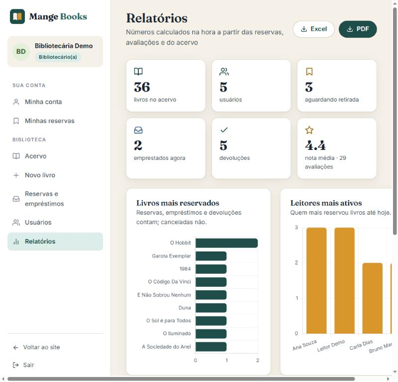

# Mange Books

[](https://github.com/DiogusVincere/mange-books/actions/workflows/ci.yml)
[](LICENSE)

Sistema de biblioteca: catálogo com busca e filtros, reservas com ciclo completo (reserva, retirada, devolução, cancelamento), avaliações com nota e comentário, dois papéis de usuário (leitor e bibliotecário) e relatórios calculados sobre os dados reais. Front em Vue 3, API em Express com MongoDB.

**Demonstração:** https://mange-books.vercel.app

| Conta | E-mail | Senha | O que faz |
| --- | --- | --- | --- |
| Bibliotecária | `demo@demo.com` | `demo1234` | acervo, reservas e empréstimos, usuários, relatórios |
| Leitor | `leitor@demo.com` | `demo1234` | reservar, avaliar, acompanhar empréstimos |

A API da demonstração roda num serviço gratuito que dorme quando ninguém usa: a primeira
requisição pode levar meio minuto. Os dados voltam ao padrão a cada reinício.

## Telas




## Funcionalidades

**Para quem visita**

- Página inicial com vitrine de capas, novidades, estantes por gênero e os mais bem avaliados.
- Catálogo com busca por título ou autor, filtro por gênero, "só disponíveis" e ordenação (recentes, título, autor, ano, nota). Os filtros ficam na URL, então dá para compartilhar `/catalogo?genero=Terror`.
- Página do livro com capa, ficha técnica, situação (disponível, reservado, emprestado), nota média, avaliações e sugestões do mesmo gênero.
- Busca rápida no cabeçalho com resultados enquanto digita.

**Para leitores (cadastro grátis)**

- Reservar um livro disponível (até três reservas em aberto por pessoa) e cancelar enquanto não retirou.
- Acompanhar cada reserva numa linha do tempo: reservado, retirado, devolvido.
- Avaliar livros com estrelas e comentário; avaliar de novo atualiza a avaliação anterior.
- Editar os próprios dados e trocar a senha.

**Para bibliotecários**

- Acervo: cadastrar, editar e excluir livros. A capa pode vir de um arquivo (até 2 MB), de uma URL ou da Open Library a partir do ISBN.
- Reservas e empréstimos: registrar retirada e devolução, cancelar reservas, filtrar por situação e buscar por livro ou leitor.
- Usuários: lista com busca, detalhe com histórico de reservas, edição, promoção a bibliotecário e exclusão.
- Relatórios: indicadores gerais, livros mais reservados, leitores mais ativos, livros mais bem avaliados e acervo por gênero, com exportação em PDF e Excel.

## Stack

| Camada | Tecnologias |
| --- | --- |
| Front | Vue 3 (`<script setup>`), Vite, vue-router, axios, Chart.js, jsPDF, SheetJS |
| API | Node.js 20, Express, Mongoose, jsonwebtoken, bcryptjs, multer |
| Banco | MongoDB (Atlas, local ou embutido no processo para demonstração e testes) |
| Testes e CI | `node:test` com `mongodb-memory-server`; GitHub Actions roda os testes da API e o build do front |

## Estrutura

```
backend/
  app.js               Express: CORS, JSON, /uploads, rotas, 404 e tratamento de erros (exporta o app)
  server.js            lê o .env, conecta ao MongoDB (ou sobe o embutido) e abre a porta
  seed.js              dados de demonstração: contas, 36 livros, avaliações e reservas
  routes/              /books, /api/auth, /reviews, /api/reservations, /api/reports
  controllers/         regras de autenticação, avaliações e reservas
  models/              User (com papel), Book, Reservation, Review
  middleware/auth.js   authMiddleware, authOpcional, comPapel, somenteBibliotecario
  test/api.test.js     testes de integração pela rede (npm test)
frontend/
  src/api.js           axios com token, tratamento de 401 e urlImagem()
  src/sessao.js        estado do usuário logado (token + perfil + papel)
  src/router/          rotas; meta.requiresAuth e meta.bibliotecario protegem o painel
  src/views/           páginas públicas e do painel (views/painel)
  src/components/      layout (cabeçalho, rodapé, painel), ui (capa, estrelas, avisos, confirmação) e formulários
  src/assets/main.css  tokens de cor e tipografia, botões, campos, cartões, tabelas
.github/workflows/ci.yml   testes da API + build do front a cada push
render.yaml                deploy da API no Render (modo demonstração por padrão)
frontend/vercel.json       deploy do front na Vercel
```

## Como rodar

Pré-requisitos: Node.js 18 ou mais novo (recomendado 20) e npm. **Não precisa de MongoDB instalado**: sem `MONGO_URI` a API sobe um MongoDB embutido no processo (baixado uma vez no `npm install`) já com os dados de demonstração.

```bash
# API (http://localhost:5000)
cd backend
cp .env.example .env     # pode deixar MONGO_URI vazio
npm install
npm run dev              # em produção: npm start

# Front (http://localhost:5173), em outro terminal
cd frontend
cp .env.example .env     # VITE_API_URL=http://localhost:5000
npm install
npm run dev
```

Com um MongoDB de verdade (Atlas ou local), preencha `MONGO_URI` e `JWT_SECRET` no `backend/.env` e rode `npm run seed` para criar os dados de exemplo. Para gerar um `JWT_SECRET` forte:

```bash
node -e "console.log(require('crypto').randomBytes(48).toString('hex'))"
```

## Testes

```bash
cd backend
npm test
```

Doze testes de integração sobem um MongoDB embutido, rodam o seed e exercitam a API pela rede: catálogo e filtros, login e cadastro, permissões por papel, livros (validação por campo, ISBN duplicado, exclusão bloqueada com reserva em aberto), avaliações (criar, atualizar, excluir), ciclo da reserva, limite de três reservas, relatórios, gestão de usuários e troca de senha. O mesmo conjunto roda no GitHub Actions a cada push.

## API

Token no cabeçalho `Authorization: Bearer <token>` (dura 12 horas). Respostas de erro vêm como `{ "message": "..." }` e, quando há validação por campo, `{ "message": "...", "erros": { "campo": "motivo" } }`.

| Método | Rota | Quem |
| --- | --- | --- |
| POST | `/api/auth/register`, `/api/auth/login` | todos |
| GET | `/api/auth/me` · PUT `/api/auth/me/senha` | logado |
| GET | `/api/auth` (lista) · DELETE `/api/auth/:id` | bibliotecário |
| GET, PUT | `/api/auth/:id` (o campo `role` só por bibliotecário) | o próprio ou bibliotecário |
| GET | `/books` (`?genero=&q=&ordem=&limite=`), `/books/recent`, `/books/search?q=`, `/books/:id` | todos (com token, `/books/:id` traz `minhaReserva`) |
| POST, PUT, DELETE | `/books`, `/books/:id` (JSON com `coverUrl` ou multipart com `coverImage`) | bibliotecário |
| GET | `/reviews/:bookId` | todos |
| POST, DELETE | `/reviews/create` (cria ou atualiza a sua), `/reviews/:reviewId` | logado (excluir: autor ou bibliotecário) |
| POST | `/api/reservations/reserve`, `/api/reservations/cancel` | logado |
| GET | `/api/reservations` (as suas), `/api/reservations/history` | logado |
| GET | `/api/reservations/todas?status=` · POST `/loan`, `/return` | bibliotecário |
| GET | `/api/reports/resumo`, `/books`, `/users`, `/ratings` | bibliotecário |

Cada livro da lista vem com `notaMedia`, `totalAvaliacoes` e `situacao` (`disponivel`, `reservado` ou `emprestado`), calculados por agregação a partir das avaliações e das reservas ativas. A capa (`coverImage`) é um caminho relativo servido em `/uploads` ou uma URL completa.

## Decisões e segurança

- **Papéis.** Quem se cadastra é sempre leitor; só um bibliotecário promove outro. Ninguém altera o próprio papel nem exclui a própria conta pela API.
- **Regras de reserva.** Um livro só tem uma reserva ativa por vez; cada leitor tem no máximo três em aberto; livro com reserva ou empréstimo em aberto não pode ser excluído; devolução só de livro emprestado; cancelamento só antes da retirada.
- **Senhas** com hash bcrypt; o hash nunca sai em resposta nenhuma. A troca de senha exige a senha atual. Login com e-mail errado e senha errada devolvem a mesma mensagem.
- **Entrada validada** no servidor com mensagem por campo (livros, cadastro, edição de usuário, avaliações). Upload aceita só imagem até 2 MB.
- **Configuração por ambiente**: `MONGO_URI`, `JWT_SECRET` e `CORS_ORIGIN` vêm do `.env`; o repositório tem só o `.env.example`.
- **Histórico do repositório reescrito** numa versão anterior para remover credenciais que haviam sido commitadas; os valores antigos foram trocados.

O que ainda não existe: renovação de token, recuperação de senha por e-mail, prazo de devolução com multa e e-mail para o leitor quando o livro é liberado.

## Implantação

- **API no Render** (`render.yaml`): *New > Blueprint* apontando para este repositório. Sem `MONGO_URI` ela sobe em modo demonstração. Para dados persistentes, acrescente `MONGO_URI` no painel do Render. No plano gratuito o disco é efêmero: capas enviadas por upload somem no reinício; use capas por URL ou um disco pago.
- **Front na Vercel** (`frontend/vercel.json`): importar o repositório com *Root Directory* = `frontend` e definir `VITE_API_URL` com a URL do Render. O rewrite para `index.html` atende ao vue-router em modo history. Pré-visualizações de outros branches (`mange-books-*.vercel.app`) já são aceitas pelo CORS da API.

## Autor

Diogo Vieira de Lima · [DiogusVincere](https://github.com/DiogusVincere)

## Licença

[MIT](LICENSE).
